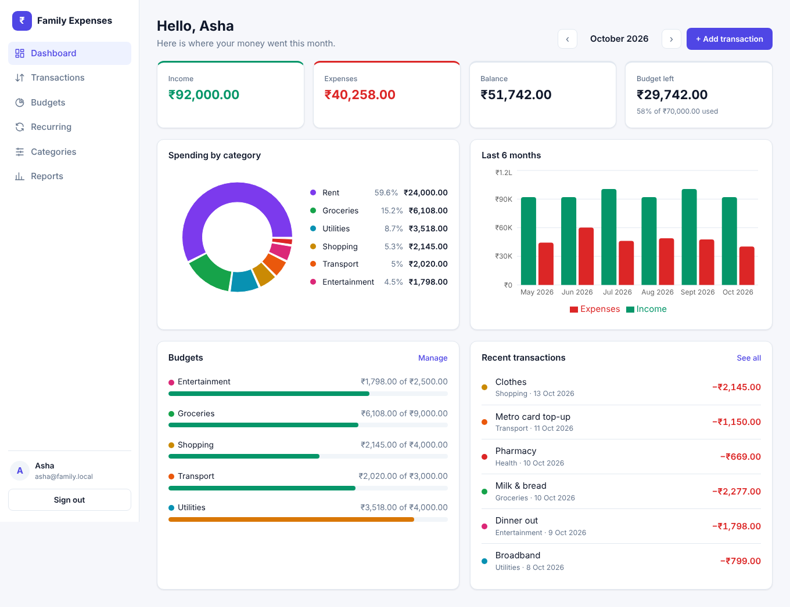

# Family Expense Tracker

A web app where each family member keeps track of their own income, expenses, budgets and recurring bills. Every account is private: nobody can see or change another member's records.

- **Frontend:** React (Vite), React Router, Recharts
- **Backend:** Java 17+, Spring Boot 4, Spring Security with JWT login
- **Database:** MySQL 8, with tables created automatically by Flyway
- **Currency:** Indian Rupee (₹)



## Features

- Separate, private account for each family member, with default categories created on sign-up
- Manual income and expense entry, with filters and search
- Your own categories, each with a color. A category that is still in use gets archived instead of deleted
- Monthly budgets, either overall or per category, with progress bars and a "copy last month" button
- Recurring bills and income (weekly, monthly or yearly), added automatically on their date
- Dashboard and reports: totals, a spending-by-category chart, and 6- and 12-month trends
- Excel and PDF export for any date range

## Run it on your computer

### 1. Install the prerequisites

| Tool | Version | Check with |
|---|---|---|
| Java (JDK) | 17 or newer | `java -version` |
| Node.js | 20 or newer | `node -v` |
| Docker Desktop | any recent version | `docker -v` |

You don't need to install Maven, because the project includes `mvnw`. Docker is only used to run MySQL; if you'd rather use a MySQL you already have, see [Using your own MySQL](#using-your-own-mysql).

### 2. Create your settings file

From the project folder:

```bash
cp .env.example .env        # Windows: copy .env.example .env
```

Open `.env` and set your own `DB_PASSWORD`, `DB_ROOT_PASSWORD` and `JWT_SECRET` (any long random text, at least 32 characters). Git ignores `.env`, so these values never get committed.

### 3. Start MySQL

```bash
docker compose up -d
```

### 4. Start the backend (port 8080)

```bash
cd backend
./mvnw spring-boot:run      # Windows: mvnw.cmd spring-boot:run
```

The first run downloads dependencies and creates the database tables. When you see `Started ExpenseTrackerApplication`, the backend is ready.

### 5. Start the frontend (port 5173)

Open a second terminal:

```bash
cd frontend
npm install
npm run dev
```

Open **http://localhost:5173**, create an account, and start adding transactions. Every family member signs up with their own email.

## Running the tests

```bash
cd backend
./mvnw test
```

The tests use an in-memory database, so they don't need Docker. They check login, the privacy rules (one user can't read, change or link to another user's records), budget and report totals, recurring-expense posting, and the Excel and PDF exports.

## Put it online with Render

The `Dockerfile` builds the React app and the Spring Boot backend into one service, so the site and the API share one web address. Render doesn't offer MySQL, so the database runs on a free MySQL from [Aiven](https://aiven.io).

1. **Aiven:** create a free account, then **Create service → MySQL → Free plan**. When it is running, open it and note the **Host**, **Port**, **User** (`avnadmin`) and **Password**.
2. **Render:** sign in with GitHub, then **New → Blueprint** and pick this repository. Render reads `render.yaml` and asks for:

   | Name | Value |
   |---|---|
   | `DB_URL` | `jdbc:mysql://HOST:PORT/defaultdb?sslMode=REQUIRED` (your Aiven host and port) |
   | `DB_USERNAME` | `avnadmin` |
   | `DB_PASSWORD` | your Aiven password |

   `JWT_SECRET` is generated for you. Click **Apply** and wait for the first deploy (about 5–10 minutes).
3. Open the `onrender.com` address Render shows. The tables are created on the first start.

On Render's free plan the service sleeps after 15 minutes without visits; the next visit takes about a minute to wake it. Pushing to `main` deploys again automatically.

## Using your own MySQL

Create the database and a user, then put the same values in `.env`:

```sql
CREATE DATABASE expense_tracker;
CREATE USER 'expense_app'@'localhost' IDENTIFIED BY 'your-password';
GRANT ALL PRIVILEGES ON expense_tracker.* TO 'expense_app'@'localhost';
```

## Project layout

```
backend/    Spring Boot API
  src/main/java/com/expensetracker/
    web/         REST controllers
    service/     business rules (budgets, recurring, reports, exports)
    repository/  database queries, always filtered by the signed-in user
    security/    JWT login
  src/main/resources/db/migration/   database schema (Flyway)
frontend/   React app
  src/pages/       one file per screen
  src/api/client.js  all calls to the backend
docs/design.md  data model, privacy rules and full API reference
```

## How privacy is enforced

1. The signed-in user's id comes only from their login token. No request can name another user.
2. Every database query is filtered by that user id. Asking for someone else's record returns "not found".
3. The database adds a second guard: transactions, budgets and recurring rules can only point at categories owned by the same user.

See [docs/design.md](docs/design.md) for details.

## Settings

All settings are read from `.env` or from environment variables:

| Name | Default | What it does |
|---|---|---|
| `DB_HOST`, `DB_PORT`, `DB_NAME` | `localhost`, `3306`, `expense_tracker` | MySQL address |
| `DB_URL` | built from the three above | Full MySQL address; replaces them when set (used for hosted MySQL) |
| `DB_USERNAME`, `DB_PASSWORD` | `expense_app`, none | MySQL login |
| `JWT_SECRET` | none (required) | Signs login tokens. At least 32 characters |
| `JWT_EXPIRATION_MINUTES` | `1440` | How long a login lasts |
| `PORT` or `SERVER_PORT` | `8080` | Backend port (Render sets `PORT`) |
| `CORS_ALLOWED_ORIGINS` | `http://localhost:5173` | Frontend address allowed to call the API |
| `RECURRING_CRON` | `0 5 0 * * *` | When recurring items are posted (default 00:05 daily; they are also posted at startup) |
